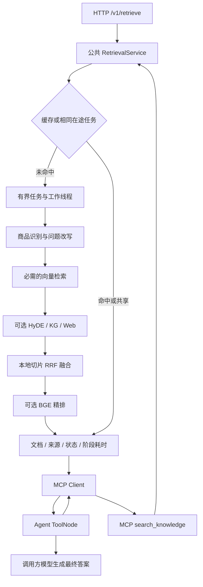

# 独立检索 MCP 服务

面向产品说明书的检索服务，为 Agent 提供来源文档、检索状态和阶段耗时。HTTP 与 MCP 共用服务层和 Pydantic 契约，支持有界 TTL 缓存、相同在途请求共享、容量限制、超时管理与检索配置对比。

本仓库是独立服务的发布版本，源码来自已有 RAG 项目的检索模块及新增工程代码。来源见 [SOURCE.md](SOURCE.md)，实际结果见 [工程验证](docs/verification.md)。



## 快速运行

Python 3.12。默认 `demo` 使用固定示例文档，不需要模型或数据库：

```bash
git clone https://github.com/Wommmm/retrieval-mcp-service.git
cd retrieval-mcp-service
python -m venv .venv
# Windows PowerShell: .\.venv\Scripts\Activate.ps1
# Linux/macOS: source .venv/bin/activate
python -m pip install .
python -m retrieval_mcp --port 8050
```

在另一个终端调用 MCP：

```bash
python -m retrieval_mcp.client "电池"
```

返回明确包含 `backend=demo` 和 `source=demo`；演示结果不能用于真实检索质量评估。


## 公共接口

| 入口 | 用途 |
|---|---|
| GET /health/live | 进程存活检查，不代表模型/数据库已经就绪 |
| POST /v1/retrieve | 检索并返回 SearchResult |
| GET /stats | 单进程请求、执行、缓存、超时与失败计数 |
| /mcp/ | Streamable HTTP，工具 search_knowledge(query, top_k=5) |

HTTP 请求示例：

```json
{
  "query": "RS-12数字万用表使用什么电池？",
  "top_k": 5,
  "routes": ["vector", "hyde", "kg"],
  "rerank": true,
  "use_cache": false
}
```

HTTP 与 MCP 返回相同结构：`schema_version`、`request_id`、`execution_id`、`backend`、`status`、`documents`、`warnings`、`traces`、`cache` 与耗时。文档有稳定标识、内容、来源、切片ID、标题、URL、分数及分数类型。

正常空结果是 `empty`，商品不明确是 `clarification`，可选路线失败是 `partial`；必需检索失败503、容量不足429、等待超时504、非法参数422。MCP工具错误返回isError。详见 [接口契约](docs/contracts.md)。

## 缓存与容量

缓存键包含查询、路线、top_k、精排开关和语料版本，容量和TTL可配置。相同配置的在途请求共享一次执行。返回深复制，避免调用者修改共享结果。`use_cache=false` 同时绕过缓存和任务合并，评测默认关闭缓存。

错误和partial不缓存。语料变化后增加 `RETRIEVAL_CORPUS_VERSION` 或重启服务。缓存范围是单知识库、单进程，不能用于不同权限用户之间的数据隔离。

同步模型在线程中运行。请求等待超时后，正在执行的模型计算可能继续，并保持容量占位；达到接纳上限后拒绝新任务，避免无限重试积累后台计算。默认CPU单工作线程、各路线顺序执行，没有跨进程限流或强制中断推理。

## Agent 使用

```python
from retrieval_mcp.client import search

result = await search("RS-12数字万用表使用什么电池？")
documents = result.documents
```

客户端管理HTTP、传输流和ClientSession生命周期，验证结构化结果。调用方检查status和warnings后再生成答案。最小LangGraph/ToolNode例子在 `examples/agent_consumer.py`：

```bash
python -m pip install '.[agent]'
python examples/agent_consumer.py
```

该示例包括两轮工具调用上限和来源回答，验证范围是单题调用链，不代表整个多Agent平台或安全审核能力。

## 测试、评测与Docker

```bash
python -m pip install '.[test]'
python -m pytest -q tests/test_contract_and_service.py tests/test_mcp_transport.py tests/test_eval.py
# 已安装live依赖时，可额外运行 tests/test_live_graph.py。
python scripts/evaluate.py --web
python -m pip wheel --no-deps . -w dist
docker compose up --build -d
```

现有5题四配置报告中，本地融合加精排Hit@5=100%、MRR=0.767；加入联网为80%、0.55。因此默认本地融合精排，联网可选。结果仅适用于该说明书5题内容标签。完整文档、排序与耗时保存在 `reports/live-ablation.json`，没有过滤未命中结果。

